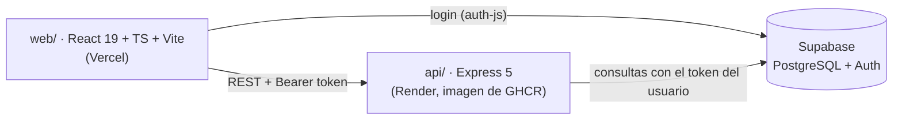

# Confirm Deliveries

Aplicación para **confirmar guías de envío y seguir cada entrega hasta su destino**: un usuario registra guías (destino, contacto, valores, proveedor), las mueve por sus estados y consulta el recorrido de cada una.

[](https://github.com/pabloAR22/confirm_deliveries/actions/workflows/ci.yml)

## Demo en vivo

- **Aplicación:** https://confirm-deliveries.vercel.app
- **API (Swagger):** https://confirm-deliveries-api.onrender.com/api/v1/docs
- **Cuenta demo:** `demo@confirm-deliveries.dev` / `demo1234` (o el botón «Entrar con la cuenta demo»)

> La demo corre en planes gratuitos. **La primera carga puede tardar 30–60 s**: Render duerme la API tras 15 min sin uso y la aplicación avisa mientras despierta. Si el proyecto lleva más de una semana sin visitas, Supabase lo pausa y hay que reactivarlo; si la demo no responde, ese es el motivo.

## Qué hace

- Inicio de sesión con Supabase Auth.
- Lista de guías con filtro por estado y conteo por estado.
- Detalle de cada guía como etiqueta de envío, con su **recorrido**: quién cambió el estado y cuándo.
- Cambio de estado, solo con las transiciones permitidas:

  ```
  confirmada ─┬─> en_transito ─┬─> entregada
              └─> cancelada    └─> devuelta
  ```

- Alta de guías con validación en el navegador, en la API y en la base de datos.
- Diseño adaptable a móvil y modo oscuro.

## Arquitectura



| Capa | Tecnología |
|---|---|
| Frontend | React 19, TypeScript, Vite, CSS plano |
| API | Node 24, Express 5, Joi, Swagger UI |
| Datos y auth | Supabase: PostgreSQL 17, Auth, RLS |
| Calidad | Vitest, Supertest, ESLint, oxlint, Prettier |
| CI/CD | GitHub Actions, Docker, GHCR, Render, Vercel |

## Decisiones técnicas

- **Las reglas de negocio viven en la base de datos.** Las validaciones son `check` constraints, las transiciones de estado las valida un trigger y el historial lo escribe otro trigger. Así se cumplen aunque alguien llame a la base sin pasar por la API. Joi y el formulario repiten las reglas solo para dar mensajes claros.
- **La API usa el token del usuario, no una clave de servicio.** Cada petición crea un cliente de Supabase con el JWT del usuario, de modo que RLS, `created_by` y el historial (`changed_by`) funcionan con su identidad real. Los tokens (ES256) se verifican con las claves públicas del proyecto (JWKS).
- **Permisos por columna.** Un usuario autenticado puede crear guías, pero solo puede actualizar el campo `status`; el resto de la guía no se puede modificar.
- **Alta atómica.** `POST /guides` acepta hasta 100 guías en un solo `INSERT`: se guardan todas o ninguna.
- **Frontend sin dependencias de más.** Sin router ni librerías de estado o UI; `<dialog>` nativo, validación HTML e `Intl` para moneda y fechas. Del SDK de Supabase solo se usa `auth-js` (bundle de 127 a 95 KB gzip).
- **Tests de integración reales.** Los tests de la API corren contra un Supabase local, también en CI, sin mocks de la base de datos.

## Límites conocidos

- Sin paginación: la API devuelve todas las guías y el filtro por estado se aplica en el navegador. Suficiente para cientos de guías; después, paginar con `range()`.
- Sin registro en la interfaz: solo la cuenta demo, para que la demo pública no se llene de cuentas.
- Los datos de la demo son compartidos: cualquier visitante puede crear guías o cambiar estados.
- En el frontend solo se prueba la lógica pura (`lib/`); las pantallas se verificaron a mano.

## Ejecutar en local

Requisitos: Node 24+ y Docker.

```bash
npx supabase start                 # Postgres + Auth en Docker; aplica migraciones y datos de ejemplo
cp api/.env.example api/.env       # completar con `npx supabase status`
cp web/.env.example web/.env       # ídem
npm --prefix api install && npm --prefix api run dev   # http://localhost:3000
npm --prefix web install && npm --prefix web run dev   # http://localhost:5173
```

Tests y lint:

```bash
npm --prefix api test && npm --prefix api run lint
npm --prefix web test && npm --prefix web run lint
```

## CI/CD

En cada pull request y en cada push a `main` (`.github/workflows/ci.yml`):

1. **api:** levanta Supabase en el runner y corre lint y tests de integración.
2. **web:** lint, tests y build.
3. En `main`, con todo en verde: publica la imagen de la API en GHCR y la despliega en Render; el frontend se despliega en Vercel.

## Origen

El proyecto empezó como una API sobre Google Cloud Functions y Firestore con JWT propio. Lo migré a PostgreSQL porque guías, estados e historial son datos relacionales, y lo completé con frontend, tests y CI/CD. La documentación del sistema original está en [`docs/legacy-firestore-api.md`](docs/legacy-firestore-api.md).

## Licencia

[MIT](LICENSE)
