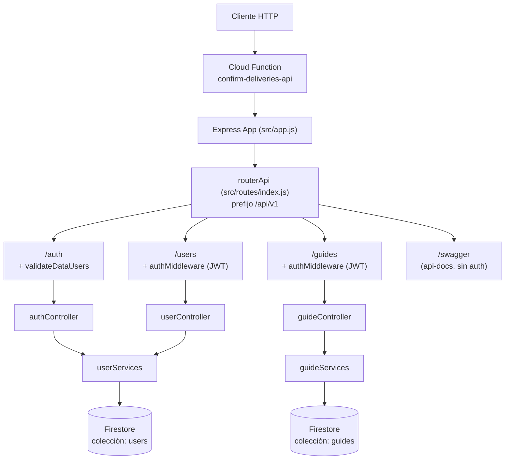
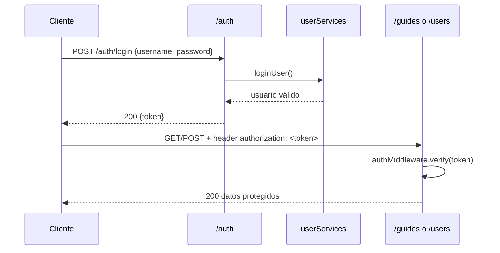

# Confirm Deliveries API — Documentación Técnica

> API REST para la gestión de confirmaciones de entregas (guías de envío), desplegada como **Google Cloud Function** sobre **Firebase/Firestore**.

## Índice
- [[#Resumen general]]
- [[#Stack tecnológico]]
- [[#Arquitectura]]
- [[#Estructura del proyecto]]
- [[#Variables de entorno]]
- [[#Flujo de autenticación]]
- [[#Endpoints de la API]]
- [[#Modelos de datos y validación]]
- [[#Persistencia (Firestore)]]
- [[#Documentación Swagger]]
- [[#Despliegue]]
- [[#Ejecución local]]
- [[#Notas y deuda técnica]]

---

## Resumen general

`confirm-deliveries-api` expone endpoints para:
- Autenticación de usuarios (registro/login con JWT).
- Consulta de usuarios registrados.
- Registro y consulta de **guías de envío** (deliveries), con validación de datos y persistencia en Firestore.

La app corre como una única Cloud Function HTTP (`confirm-deliveries-api`) que envuelve una app Express completa (patrón "Express dentro de Function Framework").

## Stack tecnológico

| Categoría | Tecnología |
|---|---|
| Runtime | Node.js 18.x |
| Framework HTTP | Express 4 |
| Hosting/Compute | Google Cloud Functions (`@google-cloud/functions-framework`) |
| Base de datos | Firebase Firestore (`firebase-admin`) |
| Autenticación | JWT (`jsonwebtoken`) + hashing con `bcryptjs` |
| Validación | `joi` |
| Documentación API | `swagger-jsdoc` + `swagger-ui-express` |
| Config | `dotenv` |
| Lint/Format | ESLint + Prettier |
| Dev | `nodemon` |

## Arquitectura



## Estructura del proyecto

```
src/
├── app.js                 # Entry point Cloud Function (Function Framework)
├── server.js               # Entry point para correr localmente con Express (puerto 3000)
├── swagger.js               # Config Swagger alternativa (no usada por las rutas activas)
├── config/
│   └── firestore.js         # Inicialización de firebase-admin + export de `db`
├── routes/
│   ├── index.js              # Router principal, monta /api/v1
│   ├── authRoutes.js          # POST /auth/register, /auth/login
│   ├── userRoutes.js           # GET /users
│   ├── guideRoutes.js           # GET/POST /guides
│   └── swaggerRoutes.js          # GET /swagger/api-docs (Swagger UI)
├── controllers/
│   ├── authController.js      # registerUser, loginUser
│   ├── userController.js       # getUsers
│   └── guideController.js       # getGuides, confirmGuides
├── middlewares/
│   ├── authMiddleware.js       # Verificación de JWT (header `authorization`)
│   ├── validateDataUsers.js     # Middleware genérico de validación Joi (usuarios)
│   └── validateGuidesData.js     # Middleware genérico de validación Joi (guías)
├── schemas/
│   ├── userSchema.js            # Joi: username, password
│   └── guidesSchema.js           # Joi: array de guías con reglas de negocio
└── services/
    ├── userServices.js            # Acceso a Firestore: users
    └── guideServices.js            # Acceso a Firestore: guides
```

Archivos de infraestructura Firebase en la raíz: `firebase.json`, `firestore.rules`, `firestore.indexes.json`, `.firebaserc` (proyecto GCP: `confirm-deliveries`).

## Variables de entorno

Cargadas vía `dotenv` (archivo `.env`, no versionado):

| Variable | Uso |
|---|---|
| `JWT_SECRET_KEY` | Clave secreta para firmar/verificar tokens JWT (`authController`, `authMiddleware`) |

Credenciales de Firebase Admin se resuelven con `applicationDefault()` (Application Default Credentials de GCP), no hay credenciales embebidas en el repo.

## Flujo de autenticación

1. `POST /api/v1/auth/register` — crea un usuario nuevo (username único, password hasheado con bcrypt).
2. `POST /api/v1/auth/login` — valida credenciales y devuelve un JWT (expira en `60m`).
3. Para consumir rutas protegidas (`/users`, `/guides`), el cliente debe enviar el token en el header `authorization` (sin prefijo `Bearer` explícito en `authMiddleware.js`, aunque Swagger lo documenta como `bearerAuth`/JWT — ver [[#Notas y deuda técnica]]).
4. `authMiddleware` verifica el token con `jwt.verify` y adjunta el payload decodificado a `req.user`.



## Endpoints de la API

Prefijo base: **`/api/v1`**

### Auth (`/auth`) — sin autenticación, con validación Joi de `userSchema`

| Método | Ruta | Descripción | Respuestas |
|---|---|---|---|
| POST | `/auth/register` | Crea un usuario nuevo | 201 creado · 409 usuario duplicado · 500 error |
| POST | `/auth/login` | Login, devuelve JWT | 200 `{message, token}` · 500 error |

> ⚠️ La validación `validateDataUsers(userSchema)` se aplica a **todo** el router `/auth`, incluido `/login`, por lo que login también exige el shape de `userSchema` (`username`, `password` requeridos).

### Users (`/users`) — requiere JWT

| Método | Ruta | Descripción | Respuestas |
|---|---|---|---|
| GET | `/users` | Lista todos los usuarios registrados | 200 array de usuarios · 500 error |

> ⚠️ El endpoint devuelve el campo `password` (hash bcrypt) en la respuesta — ver [[#Notas y deuda técnica]].

### Guides (`/guides`) — requiere JWT, con validación Joi de `guidesSchema`

| Método | Ruta | Descripción | Respuestas |
|---|---|---|---|
| GET | `/guides/getConfirmedGuides` | Lista todas las guías confirmadas | 200 array de guías · 500 error |
| POST | `/guides/confirmGuides` | Registra una o varias guías (array) | 201 creado · 409 guía duplicada · 500 error |

### Swagger (`/swagger`) — público

| Método | Ruta | Descripción |
|---|---|---|
| GET | `/swagger/api-docs` | UI de Swagger con la documentación OpenAPI 3.0 |

## Modelos de datos y validación

### `userSchema` (Joi)
- `username`: string, requerido.
- `password`: string, requerido.

### `guidesSchema` (Joi) — array de objetos guía

| Campo | Tipo | Regla |
|---|---|---|
| `guia` | string | requerido, 5–10 caracteres |
| `ubicacion` | string | requerido |
| `ciudad_destino` | string | requerido |
| `departamento_destino` | string | requerido |
| `codigo_postal` | string | requerido, exactamente 6 caracteres |
| `telefono_contacto` | string | requerido, 10 dígitos numéricos |
| `valor_productos` | number | requerido, mínimo 1 |
| `costo_envio` | number | requerido, mínimo 1 |
| `observaciones` | string | opcional, máx. 100 caracteres |
| `id_proveedor` | number | requerido |
| `numero_cuenta` | number | requerido |
| `linea_contacto` | string | opcional, máx. 50 caracteres |

El body de `POST /guides/confirmGuides` debe ser un **array** de estos objetos (`Joi.array().items(guideSchema)`).

## Persistencia (Firestore)

Colecciones usadas:
- **`users`**: `{ username, password (hash bcrypt) }`. Unicidad de `username` verificada manualmente en `userServices.createUser`.
- **`guides`**: documentos con todos los campos de `guidesSchema`. Unicidad de `guia` verificada manualmente en `guideServices.savedGuides`.

### Reglas de seguridad (`firestore.rules`)
```
allow read, write: if request.auth != null;
```
Regla abierta a cualquier documento autenticado con Firebase Auth. **Nota**: la API usa JWT propio (no Firebase Auth), así que esta regla protege el acceso directo a Firestore (p. ej. desde un cliente móvil/web con Firebase SDK), no el acceso vía esta API (que usa `firebase-admin`, con privilegios completos, bypaseando estas reglas).

No hay índices compuestos definidos (`firestore.indexes.json` vacío).

## Documentación Swagger

Existen **dos configuraciones Swagger** en el proyecto:
1. `src/swagger.js` — define specs básicos apuntando a `./routes/*.js`, pero **no se usa** en ninguna ruta activa (no está importado en `routes/index.js` ni en ningún controller).
2. `src/routes/swaggerRoutes.js` — configuración completa y activa, montada en `/api/v1/swagger/api-docs`. Define:
   - `securitySchemes.bearerAuth` (JWT)
   - Schemas: `LoginRequest`, `RegisterRequest`, `GuidesRequest`, `AuthResponse`, `ErrorResponse`, `UserResponse`, `GuidesResponse`
   - Anotaciones `@swagger` inline para `/auth/register`, `/auth/login`, `/users`, `/guides` (GET y POST)

Servers configurados apuntan a:
```
https://us-central1-confirm-deliveries.cloudfunctions.net/confirm-deliveries-api/api/v1
```

## Despliegue

- Proyecto Firebase/GCP: **`confirm-deliveries`** (región `us-central1`, ver `.firebaserc` y URLs de Swagger).
- `firebase.json` solo configura Firestore (rules + indexes); no hay configuración de `functions` ni `hosting` en este archivo, lo que sugiere que el despliegue de la función se hace directamente vía `gcloud functions deploy` (o similar) usando `@google-cloud/functions-framework`, no vía `firebase deploy`.
- Export relevante para el Function Framework en `src/app.js`:
  ```js
  functions.http('confirm-deliveries-api', app);
  exports.confirmDeliveriesApi = app;
  ```

## Ejecución local

```bash
npm install

# Modo desarrollo (nodemon, recarga automática)
npm run dev

# Modo producción/local simple
npm start
```

Requiere un archivo `.env` con `JWT_SECRET_KEY` y credenciales de GCP disponibles vía Application Default Credentials (`gcloud auth application-default login`) para que `firebase-admin` pueda conectar a Firestore.

Servidor local (`server.js`) escucha en el **puerto 3000**.

## Notas y deuda técnica

- **`src/swagger.js` sin usar**: configuración Swagger duplicada y muerta; solo `swaggerRoutes.js` está activa.
- **Documentación Swagger inconsistente**: en `swaggerRoutes.js` hay **dos bloques `@swagger` para `POST /auth/register`** (líneas ~261 y ~301); el segundo parece un copy-paste destinado a describir otro caso y pisa/duplica al primero en el spec generado.
- **`console.log(swaggerSpecs.paths)`** en `swaggerRoutes.js:236` — log de debug dejado en código de producción.
- **Validación de `/auth/login` reutiliza `userSchema`** a través del middleware montado a nivel de router (`router.use('/auth', validateDataUsers(userSchema), authRoutes)`), acoplando registro y login a la misma validación.
- **`GET /users` expone el hash de password** en la respuesta JSON (`UserResponse` en Swagger lo documenta explícitamente). Candidato a excluir el campo `password` de la respuesta.
- **Reglas de Firestore (`request.auth != null`)** no se corresponden con el modelo de autenticación real de la API (JWT propio, acceso admin desde el backend). Estas reglas solo aplican a accesos directos a Firestore fuera de esta API.
- **Variable `guideData` sin `const`/`let`** en `guideController.confirmGuides` (`for(guideData of guides)`) — crea una variable global implícita en modo no estricto.
- **Falta de índices** en `firestore.indexes.json`: las consultas por `username` y `guia` (campo único, `where(...).get()`) podrían beneficiarse de índices explícitos si las colecciones crecen.
- Typos menores en mensajes de respuesta: `"Login succesfull"` (falta una f, sobra otra L → debería ser "successful").
